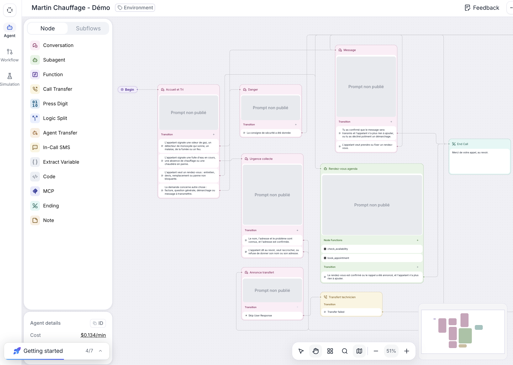
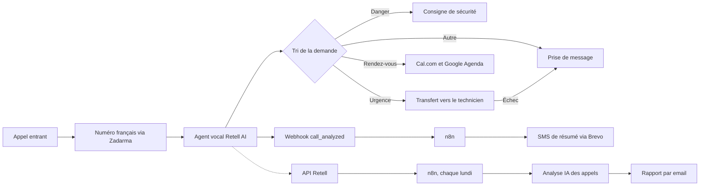
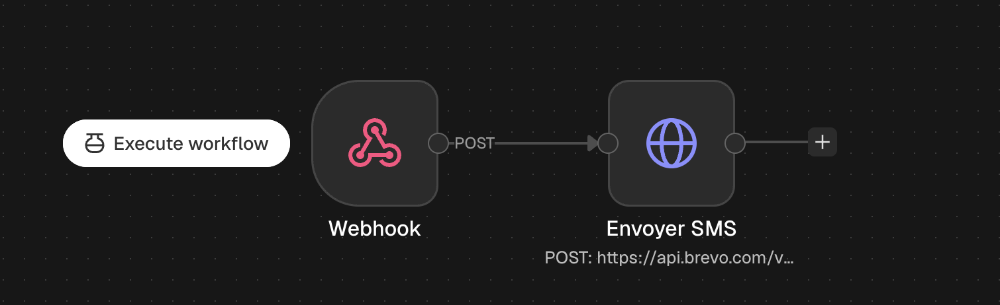
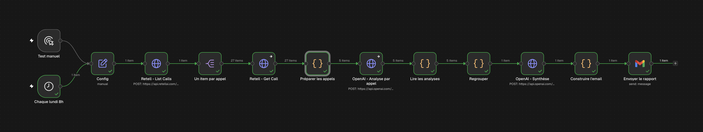
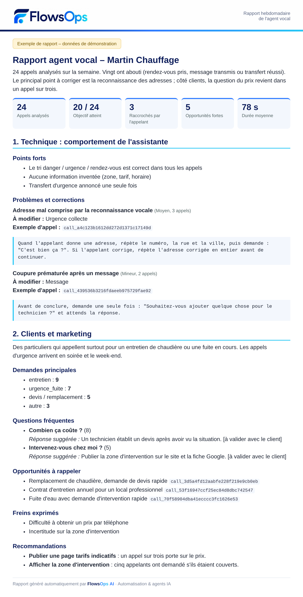

# Agent vocal IA français pour TPE/PME

[English](README.md) · Français

Démo d'assistante téléphonique IA en français, réalisée sur le cas d'un chauffagiste fictif (Martin Chauffage). Adaptable à tout métier qui reçoit des appels : artisans, cabinets, garages, agences, services à domicile.

L'agent répond à l'appel, annonce qu'il est virtuel, trie la demande, prend les rendez-vous, transfère les urgences à un technicien et prépare un résumé. Chaque semaine, un rapport automatique analyse tous les appels.

> Démo de portfolio. Il ne s'agit pas d'un agent en service chez un client.

## Fonctionnement

## Fonctionnalités

| Fonction | État |
|---|---|
| Réponse sur un numéro français | Testé |
| Tri danger, urgence, rendez-vous et autre | Testé |
| Consigne de sécurité en cas de danger | Testé |
| Vérification des disponibilités et réservation | Testé |
| Ajout du rendez-vous dans Google Agenda | Testé |
| Transfert d'urgence vers un portable | Testé |
| Prise de message si le technicien ne répond pas | Testé |
| SMS de résumé après l'appel | Testé |
| Rapport hebdomadaire par email (technique et clients) | Testé sur des appels de démonstration |

## Stack

- **Agent vocal :** Retell AI (Conversation Flow)
- **Voix :** Cartesia
- **Téléphonie :** Zadarma en SIP trunking
- **Agenda :** Cal.com et Google Agenda
- **Automatisation :** n8n auto-hébergé
- **SMS :** Brevo
- **Analyse des appels :** OpenAI
- **Email :** Gmail

## Données extraites après l'appel

| Champ | Description |
|---|---|
| `type_appel` | Danger, urgence, rendez-vous ou autre |
| `nom` | Nom de l'appelant |
| `adresse` | Adresse donnée pendant l'appel |
| `probleme` | Motif de l'appel |
| `message` | Message laissé pour le technicien |
| `creneau_rdv` | Jour et heure du rendez-vous réservé |

## Workflows n8n

### 1. SMS de résumé après chaque appel

Fichier : [`workflows/retell-sms-resume.sanitized.json`](workflows/retell-sms-resume.sanitized.json), sans données personnelles ni identifiants.

1. Importez le fichier dans n8n.
2. Associez votre credential Brevo au nœud `Envoyer SMS`.
3. Remplacez `TECHNICIAN_PHONE_NUMBER` par le numéro du destinataire, au format international sans `+` ni espaces.
4. Collez l'URL de production du webhook dans Retell.
5. Limitez l'envoi du webhook à l'événement `call_analyzed`.

### 2. Rapport hebdomadaire d'amélioration

Fichier : [`workflows/rapport-hebdo-agent-vocal.json`](workflows/rapport-hebdo-agent-vocal.json).

Chaque lundi, le workflow récupère les appels de la semaine via l'API Retell (`list-calls` v3, puis `get-call` pour les transcriptions), analyse chaque appel avec un modèle OpenAI, puis envoie un rapport par email en deux parties :

- **Technique :** comportement de l'assistante, problèmes repérés, corrections de prompt à appliquer.
- **Clients et marketing :** motifs d'appel, questions fréquentes, opportunités à rappeler, freins, recommandations.

Pour l'utiliser :

1. Importez le fichier dans n8n.
2. Dans le nœud `Config`, renseignez `agent_id` et `email_destinataire`.
3. Associez les credentials : Retell (Header Auth, nom `Authorization`, valeur `Bearer votre_clé`) dans les deux nœuds Retell, OpenAI et Gmail.
4. Dans `Préparer les appels`, réglez `VERSION_MIN` pour ignorer les appels des anciennes versions de l'agent.
5. Lancez `Test manuel`, puis activez le workflow.

*Exemple de rapport avec des données de démonstration.*

## Limites de la démo

- Les prompts et scripts complets de l'agent ne sont pas publiés.
- La vérification de la signature `X-Retell-Signature` n'est pas incluse dans le workflow de démonstration.
- Les analyses IA peuvent contenir des faux positifs : le rapport aide à repérer des pistes, il ne remplace pas la relecture des appels.
- L'analyse clients et marketing n'a de valeur qu'avec un volume d'appels suffisant (plusieurs dizaines).
- Un déploiement réel demande aussi une validation juridique, notamment pour l'information des appelants et l'enregistrement des appels.

## Auteur

Thomas Plasseraud, FlowsOps AI
