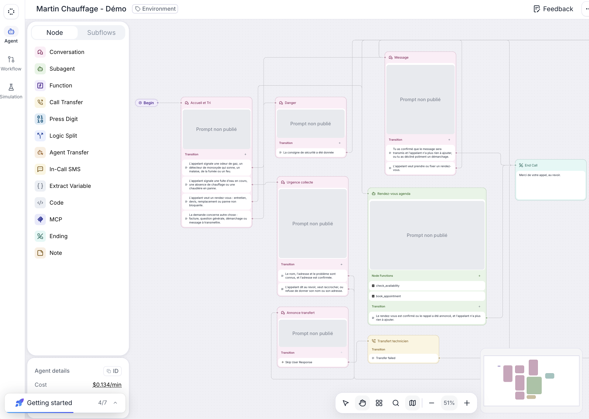
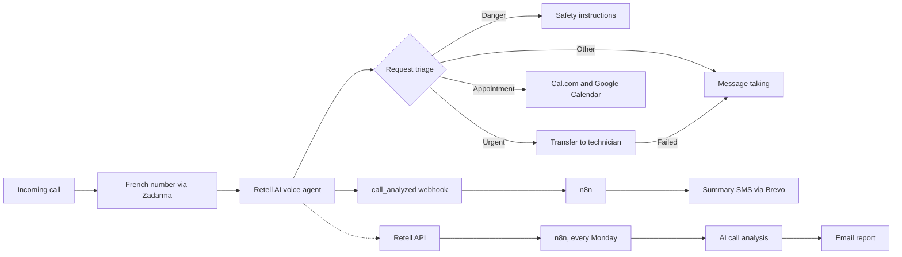
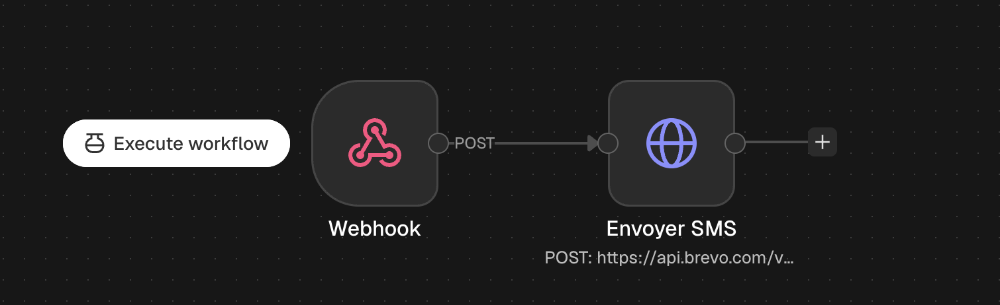
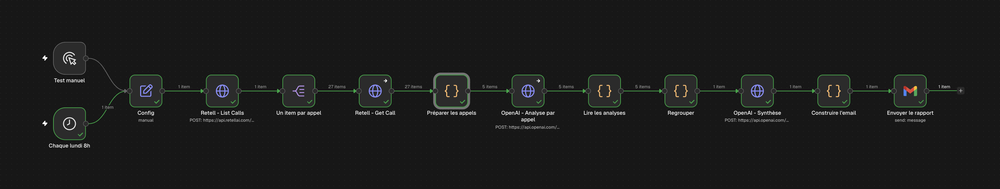
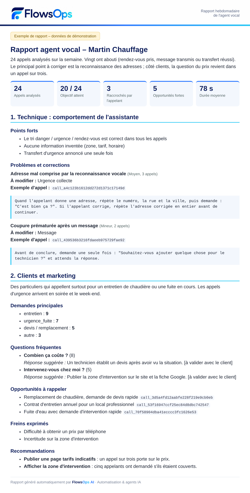

# French-speaking AI voice agent for small businesses

[English](README.md) · [Français](README.fr.md)

Demo of an AI phone assistant that speaks French, built around a fictional heating company (Martin Chauffage). Easily adapted to any business that takes phone calls: tradespeople, clinics, garages, agencies, home services.

The agent answers the call, states that it is virtual, triages the request, books appointments, transfers urgent calls to a technician and prepares a summary. Every week, an automated report analyses all calls.

> Portfolio demo. This is not an agent running for a client.

## How it works

## Features

| Feature | Status |
|---|---|
| Answers on a French phone number | Tested |
| Triage: danger, urgent, appointment, other | Tested |
| Safety instructions in case of danger | Tested |
| Availability check and booking | Tested |
| Appointment added to Google Calendar | Tested |
| Urgent transfer to a mobile phone | Tested |
| Message taking when the technician does not answer | Tested |
| Summary SMS after the call | Tested |
| Weekly email report (technical and customer insights) | Tested on demo calls |

## Stack

- **Voice agent:** Retell AI (Conversation Flow)
- **Voice:** Cartesia
- **Telephony:** Zadarma, SIP trunking
- **Calendar:** Cal.com and Google Calendar
- **Automation:** self-hosted n8n
- **SMS:** Brevo
- **Call analysis:** OpenAI
- **Email:** Gmail

## Data extracted after each call

| Field | Description |
|---|---|
| `type_appel` | Danger, urgent, appointment or other |
| `nom` | Caller's name |
| `adresse` | Address given during the call |
| `probleme` | Reason for the call |
| `message` | Message left for the technician |
| `creneau_rdv` | Day and time of the booked appointment |

Field names are kept in French, as in the Retell configuration.

## n8n workflows

### 1. Summary SMS after every call

File: [`workflows/retell-sms-resume.sanitized.json`](workflows/retell-sms-resume.sanitized.json), with no personal data or credentials.

1. Import the file into n8n.
2. Attach your Brevo credential to the `Envoyer SMS` node.
3. Replace `TECHNICIAN_PHONE_NUMBER` with the recipient's number, in international format without `+` or spaces.
4. Paste the production webhook URL into Retell.
5. Restrict the webhook to the `call_analyzed` event.

### 2. Weekly improvement report

File: [`workflows/rapport-hebdo-agent-vocal.json`](workflows/rapport-hebdo-agent-vocal.json).

Every Monday, the workflow fetches the week's calls through the Retell API (`list-calls` v3, then `get-call` for transcripts), analyses each call with an OpenAI model, then emails a two-part report:

- **Technical:** assistant behaviour, issues spotted, prompt fixes to apply.
- **Customers and marketing:** call reasons, frequent questions, callbacks to make, objections, recommendations.

To use it:

1. Import the file into n8n.
2. In the `Config` node, set `agent_id` and `email_destinataire`.
3. Attach the credentials: Retell (Header Auth, name `Authorization`, value `Bearer your_key`) on both Retell nodes, OpenAI, and Gmail.
4. In `Préparer les appels`, set `VERSION_MIN` to ignore calls from older agent versions.
5. Run `Test manuel`, then activate the workflow.

The prompts inside the workflow are written in French, since the agent speaks French. Translate them if your agent uses another language.

*Example report using demo data.*

## Limits of the demo

- The agent's full prompts and scripts are not published.
- `X-Retell-Signature` verification is not included in the demo workflow.
- AI analyses can produce false positives: the report helps surface leads, it does not replace listening to the calls.
- The customer and marketing analysis is only meaningful with enough call volume (several dozen calls).
- A real deployment also requires legal review, notably for informing callers and recording calls.

## Author

Thomas Plasseraud, FlowsOps AI
